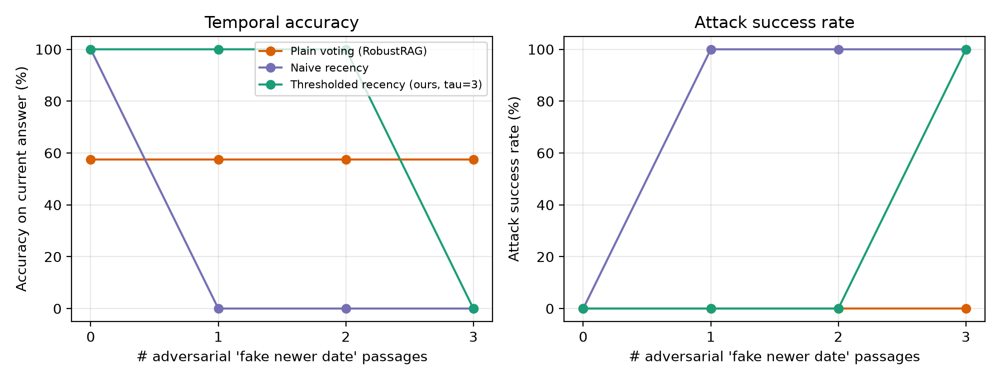

# RobustRAG recreation + thresholded recency for temporal conflicts

CS787 Group 8. Authors: Akash Tiwari (241090403) and Vaibhav Soni (241090419), IIT Kanpur. Contributor: [@vbsoni-hpc](https://github.com/vbsoni-hpc).

Small-scale recreation of *Certifiably Robust RAG against Retrieval Corruption* (Xiang et al., 2024) and an extension for temporal conflicts under bounded poisoning. Full write-up: [REPORT.md](REPORT.md).

- `src/robustrag.py`: vanilla RAG, keyword aggregation, decoding aggregation, PoisonedRAG-style attack
- `src/temporal.py`: temporal claim normalization, plain voting vs naive recency vs thresholded recency
- `src/plots.py`: figures
- `results.json`, `results_temporal.json`: raw per-question outputs
- `fig_main.png`, `fig_temporal.png`: plots

Caveats (details in the report): Qwen2.5-1.5B on a 4 GB GPU, 50/40 questions, synthetic redundant evidence and synthetic temporal data, approximate certification.
