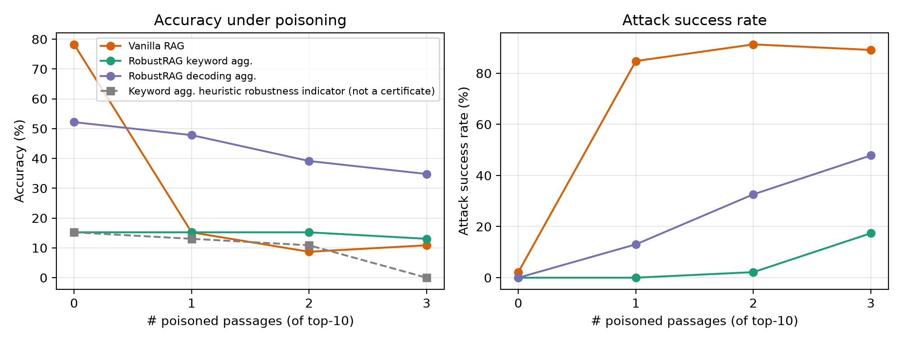

# RobustRAG: Generation Against Temporal Conflicts, Adversarial Poisoning and Hallucination

CS787 Group 8, IIT Kanpur. Authors: Akash Tiwari (241090403) and Vaibhav Soni (241090419) ([@vbsoni-hpc](https://github.com/vbsoni-hpc)).

Small-scale study of adversarial poisoning, hallucination and temporal conflicts in retrieval-augmented generation, built on *Certifiably Robust RAG against Retrieval Corruption* (Xiang et al., 2024): a recreation of RobustRAG, a hallucination (wrong-instead-of-abstain) analysis, and a thresholded-recency extension for temporal conflicts.

**Report:** [REPORT.pdf](REPORT.pdf) (same content as [REPORT.md](REPORT.md)).

## Key results
- **Poisoning:** with 1 poisoned passage out of 10, vanilla RAG outputs the attacker's answer 85% of the time; RobustRAG keyword and decoding aggregation 11% and 13%.
- **Hallucination:** isolation alone does not reduce wrong answers; abstaining (strict threshold) does, at a large cost in correct answers.
- **Temporal conflicts:** majority vote returns stale answers; "newest date wins" is broken by one forged date; our thresholded recency with robust dating resists both attacks up to the assumed budget.




## Files
- `src/robustrag.py`: vanilla RAG, keyword aggregation, decoding aggregation, PoisonedRAG-style attack (main run)
- `src/keyword_rerun.py`: paper-faithful keyword aggregation (adaptive threshold, keyphrases, keyword prompt) on the same questions
- `src/temporal.py`: claim extraction and date parsing; majority vote vs naive recency vs thresholded recency, under two attacks
- `src/plots.py`: `fig_main.png`; `src/make_pdf.py`: `REPORT.pdf`
- `results.json`, `results_keyword.json`, `results_temporal.json`: raw per-question outputs

## Reproduce
Models: Qwen2.5-1.5B-Instruct (generation) and all-MiniLM-L6-v2 (retrieval), both downloaded from Hugging Face; tested on an RTX 3050 4 GB.
```
pip install torch transformers datasets sentence-transformers matplotlib reportlab pymupdf
python src/robustrag.py 50 results.json   # about 75 min
python src/keyword_rerun.py 50            # about 10 min
python src/plots.py results.json
python src/temporal.py 40                 # about 5 min
python src/make_pdf.py
```

Caveats (details in the report): 1.5B model, 46/40 questions, synthetic redundant evidence and synthetic temporal data, no real certification (heuristic indicator only), approximate keyword extraction, hallucination measured with a coarse proxy.
